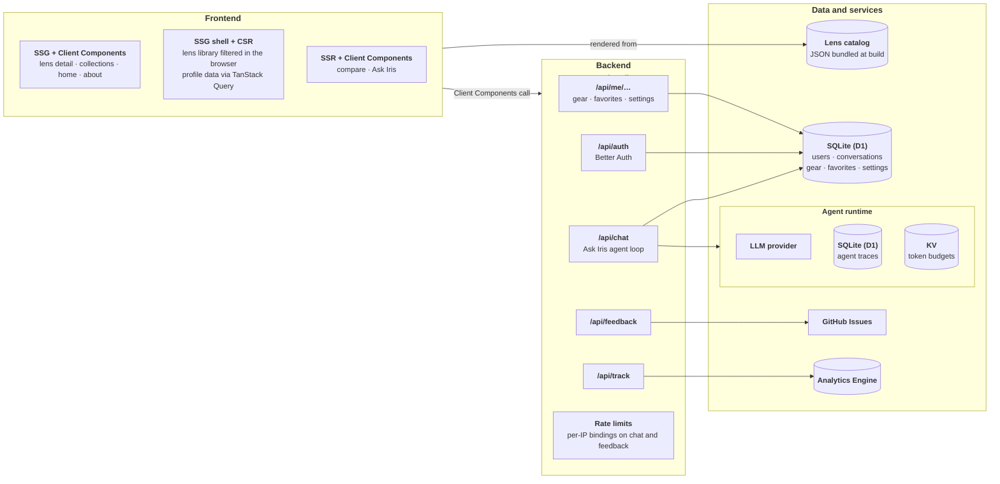
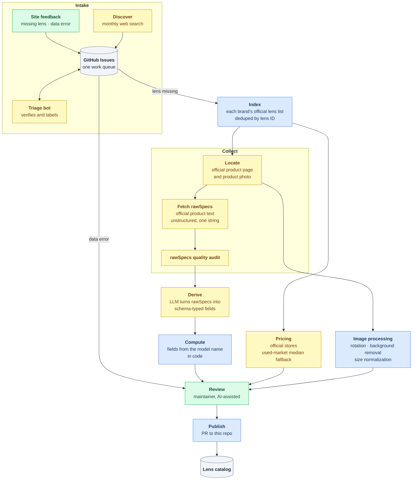

# Atlens

[](https://ko-fi.com/sentacraft)
[](https://atlens.app/zh/about#support)
[](https://github.com/sentacraft/atlens/stargazers)

> Formerly X-Glass.

Atlens is a lens database and comparison tool for Fujifilm shooters — X mount (APS-C) and G mount (GFX medium format), first-party and third-party. It turns specs scattered across manufacturers' sites into one normalized catalog of 200+ lenses, sourced from official pages by an agentic data pipeline, with an AI assistant, Ask Iris, built on top.

**English**：[atlens.app/en](https://atlens.app/en)

**简体中文**：[atlens.app/zh](https://atlens.app/zh)

Atlens is free, open source, and maintained by one person. If it helps you pick a lens, a ⭐ or a [coffee on Ko-fi](https://ko-fi.com/sentacraft) keeps it going ([微信赞赏](https://atlens.app/zh/about#support)).

**Desktop**


**Mobile**


---

## Features

- **Growing lens database** — Fujifilm's first-party lineup plus a dozen third-party brands across X and G mount; which brands and lens types are covered is kept in one place and shown live on the [coverage table](https://atlens.app/en/about#coverage)
- **Clean, focused UI** — distraction-free interface designed around the comparison workflow
- **Filter and sort** — multi-axis filtering (focal length, aperture, AF, OIS, weather resistance, specialty tags) combined with flexible sorting
- **Curated collections** — hand-picked themes (compact primes, budget autofocus, and more), each defined by filter criteria rather than a hand-picked lens list, so the lineup stays current as the catalog grows — for when you don't know exactly what to search for
- **Side-by-side comparison** of up to 4 lenses, shareable as a link or a poster image — a single lens can be shared the same way
- **Ask Iris** — a built-in AI assistant grounded in the catalog: describe what you shoot and it recommends and compares lenses with a reason for each, takes the gear you own into account when you're signed in, and answers questions about the site
- **Accounts** — save favorite lenses and the gear you own, and keep Ask Iris conversations across devices
- **Normalized data** — specs from different manufacturers use inconsistent formats and terminology; Atlens maps everything to a consistent schema so comparisons are fair and objective
- **Pipeline-backed accuracy** — specs come from official manufacturer sources and go through a staged pipeline, reviewed by the maintainer before publishing
- **Progressive Web App (PWA)** — runs in any browser, and installs like a native app on a phone's home screen or a computer's dock for full-screen access — no App Store required ([get the app](https://atlens.app/en/get))
- **Deep localization** — English and Chinese (中文) editions go beyond UI translation: pricing sources, used-market listings, and manufacturer links are all tailored to each audience's local market

## Tech Stack

| Layer | Choice |
|-------|--------|
| Framework | React 19, Next.js (App Router), TypeScript |
| Runtime & hosting | Cloudflare Workers via OpenNext |
| Data stores | SQLite (Cloudflare D1), KV, Analytics Engine |
| Auth | Better Auth — Google, email code, anonymous sessions |
| AI | Vercel AI SDK |
| Client data | TanStack Query |
| UI | Tailwind CSS, Base UI, Motion |
| i18n | next-intl |
| Validation | Zod |
| Testing | Vitest, Playwright, promptfoo (LLM evals for the Ask Iris assistant) |

## Architecture

Lens data ships with the build, so nearly every page is generated once at build time (SSG) from Server Components, and its interactive parts hydrate as Client Components. The lens library goes further: the whole catalog is sent to the browser, which filters and sorts it locally (CSR). Only compare and Ask Iris read per-request URL state and render on the server (SSR). Server components and the backend's route handlers deploy together as one Next.js app on a Cloudflare Worker.



<details>
<summary>Code layout</summary>

The split keeps logic out of components so it can later move into a shared package.

| Path | Holds |
|---|---|
| `src/app/` | Routes: localized pages under `[locale]/`, route handlers under `api/` |
| `src/components/` | Rendering only — no business logic, no `fetch` |
| `src/lib/` | Business logic, types, data access, per-feature client modules, URL query params (`url/`) |
| `src/config/ui-tokens.ts` | Shared visual language: interaction colors, buttons, selected states |
| `src/messages/` | UI copy per locale |
| `src/data/` | Lens catalog (written by the pipeline) and hand-authored collections |

</details>

## Ask Iris — Built-in AI Assistant

Ask Iris, the built-in AI assistant, is a **tool-calling agent loop** on the Vercel AI SDK. It answers from the lens catalog rather than from model memory: every lens it recommends or tabulates has to come from a tool call in the same turn.

### Tools

Seven tools in three groups: retrieval (`queryLenses`, `searchLensByName`, `lensDetails`), rendering (`recommendLenses` for cards, `listLenses` for spec tables), and context (`siteInfo` for facts about the site, `askForGear` as a client-side tool that pauses the turn for an in-chat card).

<details>
<summary>What each tool does</summary>

| Tool | Does |
|---|---|
| `queryLenses` | Recalls lenses by spec constraints |
| `searchLensByName` | Looks up a model the user named |
| `lensDetails` | Returns the full spec record for lenses already recalled |
| `recommendLenses` | Renders recommendation cards, each with a reason |
| `listLenses` | Renders a spec table |
| `siteInfo` | Returns facts about Atlens itself, by topic |
| `askForGear` | Client-side tool: shows an in-chat card asking for the user's gear, and the turn resumes when they answer |

</details>

### Context management

- **Two-tier retrieval.** `queryLenses` returns a compact record per lens — under twenty comparison fields — capped at 20 results in the sort order the model asks for, plus the total count it didn't see. The full spec record, with the long tail of optics and mechanics, comes only from `lensDetails`, for at most six lenses at a time.
- **Opaque refs.** Lenses are identified by short hashed refs, never by catalog IDs: fewer tokens, and the model can't extend a patterned ID into a lens it never retrieved.
- **Rendered output isn't echoed back.** Cards and tables carry full data to the user, but the model sees a one-line acknowledgement, both in that turn and in later turns' history.
- **Cache-friendly prompt.** The system prompt is fixed; per-user context — saved gear, or a note that it is unknown — goes in a separate system message each turn, and site facts are fetched only when asked about.

### Guardrails

- Each turn has a fixed step budget, and the last step cannot call tools.
- `lensDetails`, `recommendLenses`, and `listLenses` reject any lens not retrieved in the same turn, with an error that tells the model to look it up first.
- Requests are rate-limited per IP, and token use has daily budgets per IP and overall.
- Conversations persist in SQLite (D1), and every turn leaves a trace for debugging and analytics.

### Evals

A promptfoo suite drives the live endpoint the way the browser does and grades each reply two ways: deterministic checks on the tool-call trajectory (did it sort by reach when asked, do the picks stay in the requested focal range and budget, did the gear card appear when it should) and LLM-as-a-judge rubrics, including a judge that uses web search to flag obvious omissions.

## Data Pipeline

For a lens comparison tool, data accuracy isn't a nice-to-have — it's the product.

The catalog is maintained by an **agentic data-operations pipeline** in a private repo (`atlens-pipeline`). A **tool-calling agent** (Claude Code) drives a multi-stage workflow — index, collect, derive, compute, pricing, images — under **`PreToolUse` / `PostToolUse` hooks** and a single validated write path, so guardrails live in code rather than in the prompt. Around it, a **triage bot** (a Codex agent in GitHub Actions) screens every incoming user issue, a scheduled **LLM worker with web search** discovers new releases, and an independent **LLM-as-a-judge** audits every collected source before anything is derived from it. Verified incidents feed a **self-improvement loop** that turns them into reviewed tests, hooks, and rules. The maintainer stays **in the loop** for review and publishing. Each publish reaches this repo as a pull request.

The pipeline currently manages 248 lenses and has grown through 900+ commits since March 2026.

### Stages



Blue steps are scripts, yellow are LLM-driven, green involve a person.

GitHub Issues is the single work queue: site reports and Discover's findings land there, the triage bot labels each one and comments with what it found, confirmed missing lenses are batched by brand into the next Index run, and confirmed data errors are fixed at review.

### Agents, bots, and judges

Each component has one job, its own runtime, and an explicit list of what it must not do.

| Component | Runs | Does | Must not |
|---|---|---|---|
| **Discover** · LLM worker | Monthly GitHub Actions cron; Responses API with web search | Finds registered brands with recent X-mount releases and opens a brand-level index issue | Identify individual lenses, read user issues, or touch the catalog |
| **Triage bot** | GitHub Actions on every new issue; Codex agent | Verifies a user report against the published catalog, labels it (lens missing, data error, duplicate, …), and comments with what it found | Change data, open PRs, or close issues; issue text is treated as untrusted input and its instructions are never followed |
| **rawSpecs quality audit** · LLM-as-a-judge | After every collect write, from a `PostToolUse` hook; an independent model with no tools | Judges each collected source as ok, thin, junk, or the wrong lens; holds Derive while no source has a spec table | Write anything |
| **Pipeline agent** | Interactively under the maintainer; Claude Code | Runs Index → Collect → Derive → Compute → Pricing → Images and prepares review; given an issue number, works it through to review | Write state except through the `write` command, read this repo's published data, or publish |
| **Maintainer** · human in the loop | — | Reviews, resolves notes, and publishes | — |

### Guardrails

Rules the agents cannot talk their way around live in code, not in prompts:

- **`PreToolUse` hooks** block direct edits to lens state files and incident logs — including through shell redirects, `sed -i`, or ad-hoc scripts — and any read of this repo's published data, so an agent can't copy answers from the output it is producing.
- **One write path.** The `write` command limits each stage to its own fields, accepts only the fields an agent is allowed to derive, rejects empty placeholders for unknown values, checks that collected sources come from the brand's configured sites, re-validates the catalog schema before anything touches disk, and stamps which harness and model produced the data.
- **Readiness gates.** A stage starts only when its inputs exist (Collect needs an index entry and a valid official page; Derive needs a complete collect with a real spec source). Lenses on hold are skipped by every queue and by publish.
- **Tests in both directions.** The hooks have 24 regression cases: 11 tool calls they must block and 13 they must still allow.

### Self-correction

- **State, not memory.** Each lens has one JSON state file in git. `queue` recomputes every lens's next step from disk, so a run can stop anywhere and resume, and repeating a step is a no-op.
- **Feedback after every write.** A `PostToolUse` hook tells the agent what the lens still needs, and runs the rawSpecs quality audit after collect writes, so a thin or wrong source is caught before Derive builds on it.
- **Uncertainty is surfaced, not guessed.** Derive writes only what the source supports; conflicts, schema gaps, and mismatches become notes that the maintainer resolves at review.
- **Rollback.** `reset` returns a lens to an earlier stage and clears what came after it.

### Self-improvement

The pipeline keeps an append-only, git-tracked log of verified process incidents — a failed action, a recurring collection failure, a step the maintainer had to correct. Each incident moves from **open** to **resolved** to **promoted**. A review reads the open incidents and proposes one concrete change: a test, a hook, a CLI check, a source configuration, or a stage rule. It becomes a rule only after it is reviewed and merged, and only then is the incident marked promoted. No agent rewrites its own prompts, rules, or data silently.

### Principles

- Specs come from manufacturers' official pages; in rare cases a field missing there is filled at review from other published sources.
- Deterministic fields are computed in code — never inferred by an LLM.
- Agents propose; code enforces; the maintainer approves what ships.

**A note on accuracy.** Atlens covers hundreds of lenses across dozens of spec dimensions, and we kindly ask for your patience with the small errors and stale entries that slip through. Bug reports via the in-app feedback or GitHub issues are very welcome — for anything critical to a purchase, please confirm on the manufacturer's official page first.

## Local Development

Requires Node 25 (see `.nvmrc`) and pnpm.

```bash
pnpm install
cp .env.example .env.local

# Create the local D1 databases
pnpm exec wrangler d1 migrations apply atlens-app --local
pnpm exec wrangler d1 migrations apply atlens-askiris-traces --local
pnpm exec wrangler d1 migrations apply atlens-analytics --local
pnpm exec wrangler d1 migrations apply atlens-catalog --local

pnpm run dev
```

Open [http://localhost:3000](http://localhost:3000). Browsing, filtering, and comparing need no configuration. Other features need values in `.env.local` (each is described in `.env.example`):

| Feature | Needs |
|---|---|
| Sign-in and accounts | `BETTER_AUTH_SECRET` (any random string locally); Google sign-in also needs `GOOGLE_CLIENT_ID` and `GOOGLE_CLIENT_SECRET` and works only on port 3000 or 8787. Email codes aren't sent locally — the local email binding writes them to disk. |
| Ask Iris | `BETTER_AUTH_SECRET`, `ANALYTICS_ID_SECRET`, and the model key named in `.env.example` |
| Feedback form | `GITHUB_TOKEN` and `GITHUB_FEEDBACK_REPO` |

`pnpm run preview` builds and serves the app on the real Cloudflare Workers runtime (workerd), which catches issues `next dev` can't.

## Contributing

Small fixes are welcome. For larger code changes or new features, please open an issue first so we can align on scope before implementation.

To report a data issue (wrong spec, broken image) or suggest a missing lens, use the feedback links inside the app, or open a [GitHub Issue](https://github.com/sentacraft/atlens/issues).

If you find Atlens useful, a ⭐ on this repo goes a long way — and if you'd like to support the project: [donate](https://atlens.app/en/about#support) · [打赏](https://atlens.app/zh/about#support)

## Affiliate Disclosure

Building Atlens involves curating and cross-checking specs from dozens of manufacturer sites, collecting price reference data, and running a multi-stage data pipeline — an ongoing effort, not a one-time build. Some pages include retailer links, a few of which are affiliate links — if you purchase through them, Atlens earns a small commission at no extra cost to you. This helps sustain that work. Affiliate partnerships never influence rankings or pricing data.

## Forking for Other Mounts

Atlens covers Fujifilm only, and forks for other systems are welcome. [docs/FORKING.md](docs/FORKING.md) covers what the MIT license includes, what it doesn't (the lens data and the pipeline), what to expect when adapting it, and a few asks around naming.

## Acknowledgments

Developed solo, with heavy use of AI tooling: [Claude Code](https://claude.ai/code) as an engineering/coding partner; Claude Design and [Google Gemini](https://gemini.google.com) as design advisors.

Built on the shoulders of great open source work: [Base UI](https://base-ui.com), [Motion](https://motion.dev), [Lucide](https://lucide.dev), [next-intl](https://next-intl.dev), [Zod](https://zod.dev), [Tailwind CSS](https://tailwindcss.com), [modern-screenshot](https://github.com/qq15725/modern-screenshot), [qrcode.react](https://github.com/zpao/qrcode.react), [Geist](https://vercel.com/font).

## License

**Source code** — [MIT](LICENSE) © 2026 SentaCraft

**Lens data** — [Proprietary](LICENSE-DATA) © 2026 SentaCraft
Available for personal reference only. Redistribution, commercial use, and bulk scraping are not permitted.

**Product images and brand trademarks** are the property of their respective owners.
Atlens is an independent third-party tool, not affiliated with or endorsed by any manufacturer.
Rights holders may contact [me@atlens.app](mailto:me@atlens.app) for takedown requests.
