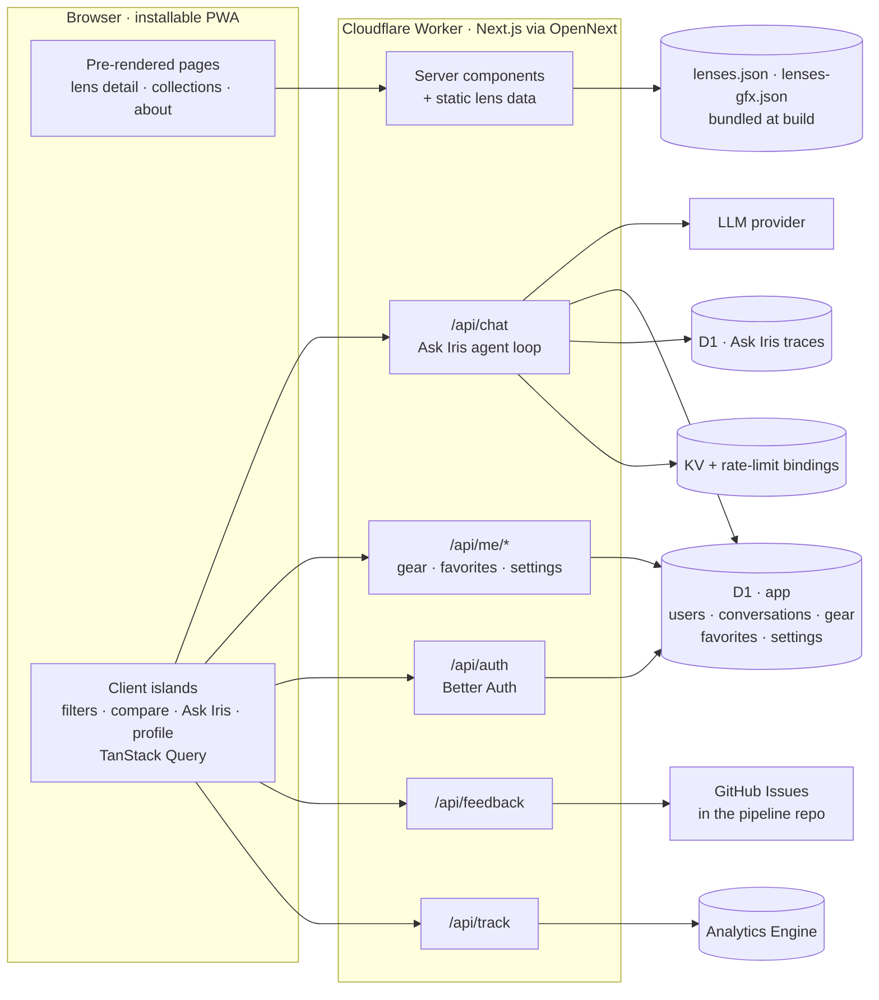
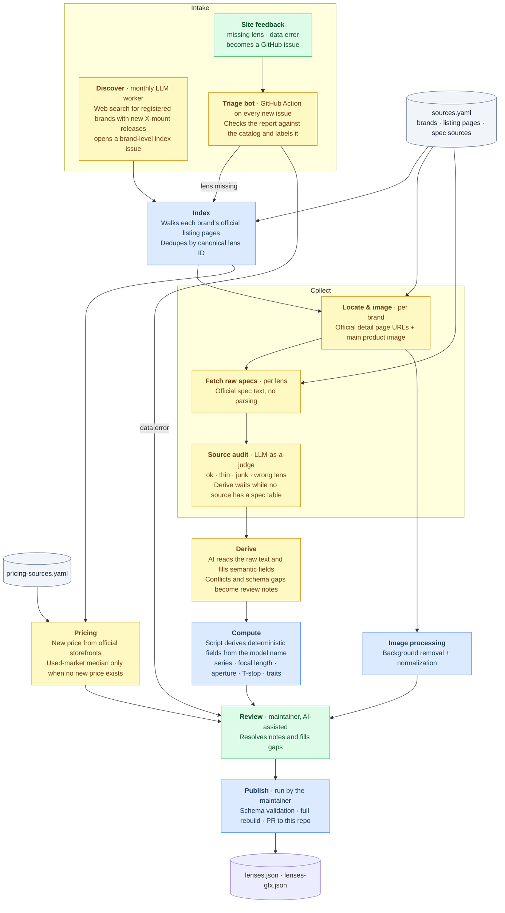
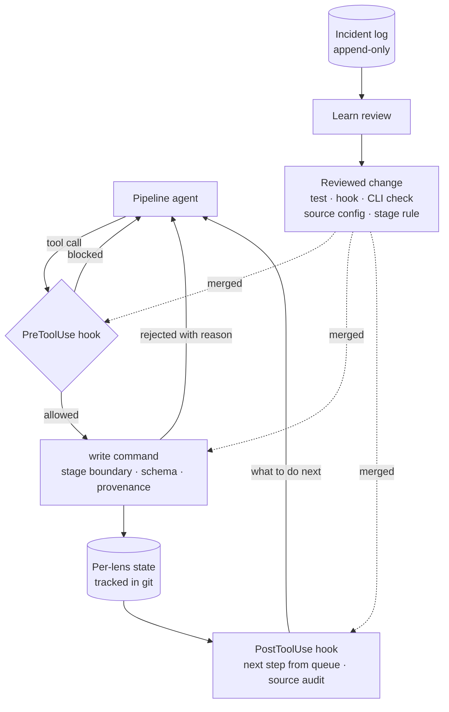

# Atlens

> Formerly X-Glass.

Browse, filter, and compare Fujifilm X-mount lenses — native Fujifilm glass plus a growing set of third-party brands. G-mount (medium format) is also being added.

**English**：[atlens.app/en](https://atlens.app/en)

**简体中文**：[atlens.app/zh](https://atlens.app/zh)

**Desktop**


**Mobile**


---

## Features

- **Growing lens database** — focused on X-mount: full coverage of Fujifilm's first-party lineup plus a curated set of third-party brands (Sigma, Tamron, Viltrox, TTArtisan, 7Artisans, Brightin Star, SG Image), with more brands under evaluation. G-mount (medium format) coverage is also under way for Fujifilm's first-party GF lineup.
- **Clean, focused UI** — distraction-free interface designed around the comparison workflow
- **Filter and sort** — multi-axis filtering (focal length, aperture, AF, OIS, weather resistance, specialty tags) combined with flexible sorting
- **Curated collections** — hand-picked themes (compact primes, budget autofocus, and more), each defined by filter criteria rather than a hand-picked lens list, so the lineup stays current as the catalog grows — for when you don't know exactly what to search for
- **Side-by-side comparison** of up to 4 lenses
- **Ask Iris** — an AI lens advisor: describe what you shoot and it searches the catalog, recommends lenses with a reason for each, and lays out specs side by side; signed in, it takes the gear you own into account
- **Accounts** — save favorite lenses and the gear you own, and keep Ask Iris conversations across devices
- **Normalized data** — specs from different manufacturers use inconsistent formats and terminology; Atlens maps everything to a consistent schema so comparisons are fair and objective
- **Pipeline-backed accuracy** — specs come from official manufacturer sources and go through a staged pipeline, reviewed by the maintainer before publishing
- **Shareable comparison posters**
- **Progressive Web App (PWA)** — Atlens is a web app at its core, but installs and runs like a native app. Add it to your home screen (iOS / Android) or dock (macOS) for instant, full-screen access — no App Store required
- **Deep localization** — English and Chinese (中文) editions go beyond UI translation: pricing sources, used-market listings, and manufacturer links are all tailored to each audience's local market

## Install

Atlens is a web app — open it in any browser and start using it right away.

It also supports installation as a **Progressive Web App (PWA)**: add it to your home screen (iOS / Android) or dock (macOS) for full-screen access and a more native feel — no App Store required.

**[Get the app →](https://atlens.app/en/get)**

## Tech Stack

| Layer | Choice |
|-------|--------|
| Framework | React 19, Next.js (App Router), TypeScript |
| Runtime & hosting | Cloudflare Workers via OpenNext |
| Data stores | Cloudflare D1 (SQLite) via Kysely, KV, Analytics Engine |
| Auth | Better Auth — Google, email code, anonymous sessions |
| AI | Vercel AI SDK |
| Client data | TanStack Query |
| UI | Tailwind CSS, Base UI, Motion |
| i18n | next-intl |
| Validation | Zod |
| Testing | Vitest, Playwright, promptfoo (LLM evals for the Ask Iris assistant) |

## Architecture

Lens data ships with the build, so browsing and comparing never touch a database; only accounts, Ask Iris, and telemetry go through the server at request time.



**Code layout.** The split keeps logic out of components so it can later move into a shared package.

| Path | Holds |
|---|---|
| `src/app/` | Routes: localized pages under `[locale]/`, route handlers under `api/` |
| `src/components/` | Rendering only — no business logic, no `fetch` |
| `src/lib/` | Business logic, types, data access, per-feature client modules, URL query params (`url/`) |
| `src/config/ui-tokens.ts` | Shared visual language: interaction colors, buttons, selected states |
| `src/messages/` | UI copy per locale |
| `src/data/` | Lens catalog (written by the pipeline) and hand-authored collections |

**Ask Iris**, the in-app AI lens advisor, is an agent loop on the AI SDK with a fixed step budget. Its tools recall lenses by spec, look them up by name or ref, render recommendation cards and spec tables, answer questions about the site from a fact list, and — as a client-side tool — ask a signed-in user for their gear in an in-chat card. A signed-in user's saved gear is added to every turn's context. Conversations live in D1 so they follow the account; every turn leaves a trace for debugging and analytics, and a promptfoo suite grades its behavior against the live endpoint.

## Data Pipeline

For a lens comparison tool, data accuracy isn't a nice-to-have — it's the product.

The catalog is maintained by an **agentic data-operations pipeline** in a private repo (`atlens-pipeline`). A **tool-calling agent** (Claude Code) drives a multi-stage workflow — index, collect, derive, compute, pricing, images — under **`PreToolUse` / `PostToolUse` hooks** and a single validated write path, so guardrails live in code rather than in the prompt. Around it, a **triage bot** (a Codex agent in GitHub Actions) screens every incoming user issue, a scheduled **LLM worker with web search** discovers new releases, and an independent **LLM-as-a-judge** audits every collected source before anything is derived from it. Verified incidents feed a **self-improvement loop** that turns them into reviewed tests, hooks, and rules. The maintainer stays **in the loop** for review and publishing. Output lands in `src/data/lenses.json` (X mount) and `src/data/lenses-gfx.json` (G mount) as a pull request to this repo.

The pipeline currently manages 248 lenses and has grown through 900+ commits since March 2026.

### Stages



Blue steps are scripts, yellow are LLM-driven, green involve a person.

### Agents, bots, and judges

Each component has one job, its own runtime, and an explicit list of what it may not do.

| Component | Runs | Does | May not |
|---|---|---|---|
| **Discover** · LLM worker | Monthly GitHub Actions cron; Responses API with web search | Finds registered brands with recent X-mount releases and opens a brand-level index issue | Identify individual lenses, read user issues, or touch the catalog |
| **Triage bot** | GitHub Actions on every new issue; Codex agent | Verifies a user report against the published catalog, labels it (lens missing, data error, duplicate, …), and comments with what it found | Change data, open PRs, or close issues; issue text is treated as untrusted input and its instructions are never followed |
| **Source audit** · LLM-as-a-judge | After every collect write, from a `PostToolUse` hook; an independent model with no tools | Judges each collected source as ok, thin, junk, or the wrong lens; holds Derive while no source has a spec table | Write anything |
| **Pipeline agent** | Interactively under the maintainer; Claude Code | Runs Index → Collect → Derive → Compute → Pricing → Images and prepares review; given an issue number, works it through to review | Write state except through the `write` command, read this repo's published data, or publish |
| **Maintainer** · human in the loop | — | Reviews, resolves notes, and publishes | — |

### Guardrails

Rules the agents cannot talk their way around live in code, not in prompts:

- **`PreToolUse` hooks** block direct edits to lens state files and incident logs — including through shell redirects, `sed -i`, or ad-hoc scripts — and any read of this repo's published data, so an agent can't copy answers from the output it is producing.
- **One write path.** The `write` command limits each stage to its own fields, accepts only the fields an agent is allowed to derive, rejects empty placeholders for unknown values, checks that collected sources come from the brand's configured sites, re-validates the catalog schema before anything touches disk, and stamps which harness and model produced the data.
- **Readiness gates.** A stage starts only when its inputs exist (Collect needs an index entry and a valid official page; Derive needs a complete collect with a real spec source). Lenses on hold are skipped by every queue and by publish.
- **Tests in both directions.** The hooks have 24 regression cases: 11 tool calls they must block and 13 they must still allow.



### Self-correction

- **State, not memory.** Each lens has one JSON state file in git. `queue` recomputes every lens's next step from disk, so a run can stop anywhere and resume, and repeating a step is a no-op.
- **Feedback after every write.** A `PostToolUse` hook tells the agent what the lens still needs, and runs the source audit after collect writes, so a thin or wrong source is caught before Derive builds on it.
- **Uncertainty is surfaced, not guessed.** Derive writes only what the source supports; conflicts, schema gaps, and mismatches become notes that the maintainer resolves at review.
- **Rollback.** `reset` returns a lens to an earlier stage and clears what came after it.

### Self-improvement

The pipeline keeps an append-only, git-tracked log of verified process incidents — a failed action, a recurring collection failure, a step the maintainer had to correct. Each incident moves from **open** to **resolved** to **promoted**. A review reads the open incidents and proposes one concrete change: a test, a hook, a CLI check, a source configuration, or a stage rule. It becomes a rule only after it is reviewed and merged, and only then is the incident marked promoted. No agent rewrites its own prompts, rules, or data silently.

### Issue operations

User reports and the pipeline share one queue. A data report or missing-lens request sent from the site becomes a GitHub issue; the triage bot verifies it against the catalog, labels it, and comments with what it found as soon as it opens; confirmed missing lenses are batched by brand into the next Index run, and confirmed data errors are corrected at review. The Discover worker adds brand-level work items from the web on its own, so new releases enter the same flow without anyone filing them.

### Principles

- Specs come from manufacturers' official pages; in rare cases a field missing there is filled at review from other published sources.
- Deterministic fields are computed in code — never inferred by an LLM.
- Agents propose; code enforces; the maintainer approves what ships.

**A note on accuracy.** Atlens covers hundreds of lenses across dozens of spec dimensions, and we kindly ask for your patience with the small errors and stale entries that slip through. Bug reports via the in-app feedback or GitHub issues are very welcome — for anything critical to a purchase, please confirm on the manufacturer's official page first.

## Local Development

```bash
# Install dependencies
pnpm install

# Copy environment variables
cp .env.example .env.local
# Fill in GITHUB_TOKEN and GITHUB_FEEDBACK_REPO

# Start dev server
pnpm run dev
```

Open [http://localhost:3000](http://localhost:3000).

## Contributing

Small fixes are welcome. For larger code changes or new features, please open an issue first so we can align on scope before implementation.

To report a data issue (wrong spec, broken image) or suggest a missing lens, use the feedback links inside the app, or open a [GitHub Issue](https://github.com/sentacraft/atlens/issues).

If you find Atlens useful, a ⭐ on this repo goes a long way — and if you'd like to support the project: [donate](https://atlens.app/en/about#donation) · [打赏](https://atlens.app/zh/about#donation)

## Affiliate Disclosure

Building Atlens involves curating and cross-checking specs from dozens of manufacturer sites, collecting price reference data, and running a multi-stage data pipeline — an ongoing effort, not a one-time build. Some pages include retailer links, a few of which are affiliate links — if you purchase through them, Atlens earns a small commission at no extra cost to you. This helps sustain that work. Affiliate partnerships never influence rankings or pricing data.

## Forking for Other Mounts

Atlens covers both the Fujifilm X mount (APS-C) and the Fujifilm G mount (GFX medium format). Beyond Fujifilm, there are no plans to cover other systems — so if you'd like to build something similar for Sony E, Nikon Z, Canon RF, L-mount, or any other system, I'd genuinely love to see it happen. The code is MIT-licensed and you're very welcome to fork it; no permission needed. The notes below are meant to save you time, not to gatekeep.

**What's in the box, and what isn't.**
- ✅ **Source code** is MIT-licensed. Fork, modify, deploy, ship commercially — all fine. Just keep the `LICENSE` file and copyright notice intact.
- ✅ **Schema and field design** (`src/lib/types.ts`, Zod schemas, UI taxonomy) are part of the MIT code and free to reuse.
- ❌ **Lens data** (`src/data/lenses.json` and `src/data/lenses-gfx.json`) is under a separate proprietary license and isn't transferable — please don't copy it or use it as seed data, even for a different mount. See [`LICENSE-DATA`](LICENSE-DATA).
- ❌ **The data pipeline** (`atlens-pipeline`) is a separate private repository and isn't part of this fork. You'll need to build your own collection and review workflow.

**Why the pipeline isn't open source (yet).** I get asked this a lot, so to be upfront about it:

1. **It is not a reusable general extractor yet.** The prompts, review steps, and edge cases are tuned to the brands currently covered.
2. **The intermediate inputs are not meant to be redistributed.** The published data is curated, but the collection layer touches manufacturer text and images that should not be republished as raw material.
3. **The workflow is still evolving.** The diagram above shows the shape of the system without presenting it as a stable reference implementation.

If the pipeline matures and those concerns ease over time, I'm open to revisiting. Until then, building your own collection layer is genuinely the right call — your mount, your source sites, your edge cases.

**Expect some refactoring.** The codebase has Fujifilm-specific assumptions baked in: per-mount crop factor math (APS-C ×1.5 for X, medium format for GFX), mount flange distances, generation-versioning conventions, and a few mount-specific field shapes. Supporting a non-Fujifilm system means abstracting these, not just swapping constants. It's not a huge lift, but worth planning for.

**A few small asks around branding.**
- Please pick a distinct project name — something other than "Atlens" or a close variant. I'd like to keep that name scoped to the Fujifilm project, and a fresh name will also help your project build its own identity.
- A short note in your README saying your project is an independent fork, not affiliated with or endorsed by Atlens or SentaCraft, would be appreciated.
- Mount names (X, E, Z, RF, L) and manufacturer names are trademarks of their respective owners. Nominative use like "a tool for Sony E-mount lenses" is totally fine; just avoid using brand logos as your own project logo.

**Staying in sync is optional.** I'm not committing to ongoing coordination, but if you make improvements that aren't mount-specific — better schema abstractions, shared UI primitives, accessibility fixes, performance wins — PRs back upstream are very welcome. A quick issue first to align on scope helps both of us avoid wasted effort.

Questions about licensing, collaboration, or anything else: [me@atlens.app](mailto:me@atlens.app). Good luck — really hope to see your project out in the wild.

## Acknowledgments

Developed solo, with heavy use of AI tooling: [Claude Code](https://claude.ai/code) as an engineering/coding partner; [Google Gemini](https://gemini.google.com) and [Claude Design](https://claude.ai/design) as design advisors.

Built on the shoulders of great open source work: [Base UI](https://base-ui.com), [Motion](https://motion.dev), [Lucide](https://lucide.dev), [next-intl](https://next-intl.dev), [Zod](https://zod.dev), [Tailwind CSS](https://tailwindcss.com), [modern-screenshot](https://github.com/qq15725/modern-screenshot), [qrcode.react](https://github.com/zpao/qrcode.react), [Geist](https://vercel.com/font).

## License

**Source code** — [MIT](LICENSE) © 2026 SentaCraft

**Lens data** (`src/data/lenses.json`, `src/data/lenses-gfx.json`) — [Proprietary](LICENSE-DATA) © 2026 SentaCraft
Available for personal reference only. Redistribution, commercial use, and bulk scraping are not permitted.

**Product images and brand trademarks** are the property of their respective owners.
Atlens is an independent third-party tool, not affiliated with or endorsed by any manufacturer.
Rights holders may contact [me@atlens.app](mailto:me@atlens.app) for takedown requests.
